## A chemical route through this session

Connect reaction planning to recorded amounts and evidence. Keep theoretical product, isolated yield, conversion, identity and purity as separate claims.

::: notes
45-minute budget: retrieval 4 min; route planning 5 min; amount/limiting-reagent calculations with paper checks 12 min; theoretical and isolated yield 8 min; TLC and spectral evidence 10 min; report critique and exit 6 min. Total 45 min, including calculation and discussion.

Suggested 30 seconds; adjust to the explanation and class response. Plan 45 minutes including short drawing and discussion intervals. Routine visual frames take roughly 40 seconds; worked checks need longer and some resolutions can be quicker. Treat timings as guidance, with room for questions.
:::

## Retrieve the starting idea

Write amount = mass / molar mass with units. What quantity results from g divided by g/mol?

::: notes
Suggested 30 seconds; adjust to the explanation and class response. Give students a short individual attempt. Worked answer: Mol. Calculate amounts before comparing reagents and include balanced coefficients.
:::

## Begin with functional-group changes

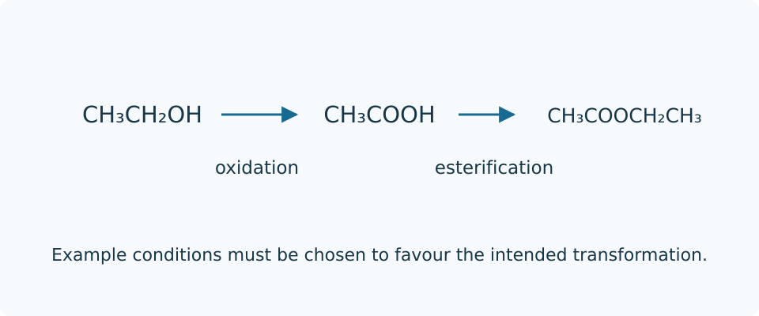{width=85% fig-alt="Two simple transformations connect an alcohol and an ester"}

Which two transformations connect ethanol to the ester through an acid?

::: notes
Suggested 40 seconds; adjust to the explanation and class response. Ask students to inspect the indicated molecular feature rather than read the answer caption. Worked answer: Oxidation gives ethanoic acid; acid-catalysed esterification with another ethanol portion gives ethyl ethanoate.
:::

## Apply: begin with functional-group changes

Where does the ethoxy fragment of the final ester come from?

::: notes
Suggested 60 seconds; adjust to the explanation and class response. Allow a brief paper or pair check within this slide. Worked answer: A separate ethanol portion supplies the O–CH₂CH₃ fragment in the esterification step.
:::

## Choose the intended oxidation endpoint

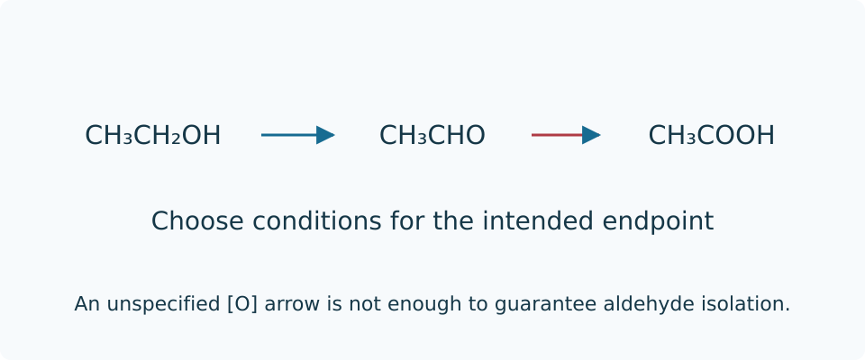{width=85% fig-alt="An aldehyde target requires a different stopping point"}

Why is an unspecified oxidation arrow insufficient for an aldehyde target?

::: notes
Suggested 40 seconds; adjust to the explanation and class response. Ask students to inspect the indicated molecular feature rather than read the answer caption. Worked answer: An aldehyde can undergo further oxidation. Conditions must favour its formation and isolation rather than the acid.
:::

## Apply: choose the intended oxidation endpoint

Is stopping oxidation early the same as proving pure ethanal?

::: notes
Suggested 60 seconds; adjust to the explanation and class response. Allow a brief paper or pair check within this slide. Worked answer: No. Product identity and purity require suitable observations, not just a target label or reaction time.
:::

## Inspect the actual aspirin transformation

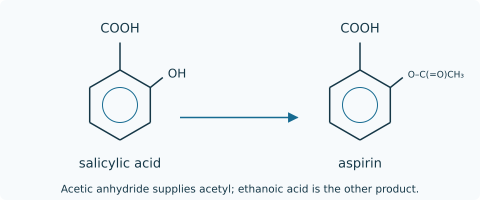{width=85% fig-alt="Aspirin formation acetylates the phenolic oxygen"}

Which oxygen-containing site changes and which acid group remains?

::: notes
Suggested 40 seconds; adjust to the explanation and class response. Ask students to inspect the indicated molecular feature rather than read the answer caption. Worked answer: The phenolic oxygen receives an acetyl group; the carboxylic acid remains. The target contains an ester and an acid.
:::

## Apply: inspect the actual aspirin transformation

Would every O–H-related feature necessarily disappear after successful acetylation?

::: notes
Suggested 60 seconds; adjust to the explanation and class response. Allow a brief paper or pair check within this slide. Worked answer: No. Carboxylic acid O–H remains, even though the phenolic OH has changed.
:::

## Balance the amount calculation first

{width=85% fig-alt="An amount table follows a balanced equation"}

What mole ratio connects the two reagents and aspirin?

::: notes
Suggested 40 seconds; adjust to the explanation and class response. Ask students to inspect the indicated molecular feature rather than read the answer caption. Worked answer: The supplied teaching equation is salicylic acid + acetic anhydride → aspirin + ethanoic acid, all coefficients one.
:::

## Resolve: balance the amount calculation first

{width=85% fig-alt="An amount table follows a balanced equation"}

The supplied teaching equation is salicylic acid + acetic anhydride → aspirin + ethanoic acid, all coefficients one.

::: notes
Suggested 30 seconds; adjust to the explanation and class response. Use a second inspection focus: justify the result by the atom, charge, ratio or observation involved. Next application answer: It accounts for the remaining atoms and confirms the balanced net transformation, even though aspirin is the target.
:::

## Apply: balance the amount calculation first

Why include the ethanoic acid product in the equation?

::: notes
Suggested 60 seconds; adjust to the explanation and class response. Allow a brief paper or pair check within this slide. Worked answer: It accounts for the remaining atoms and confirms the balanced net transformation, even though aspirin is the target.
:::

## Convert mass to chemical amount

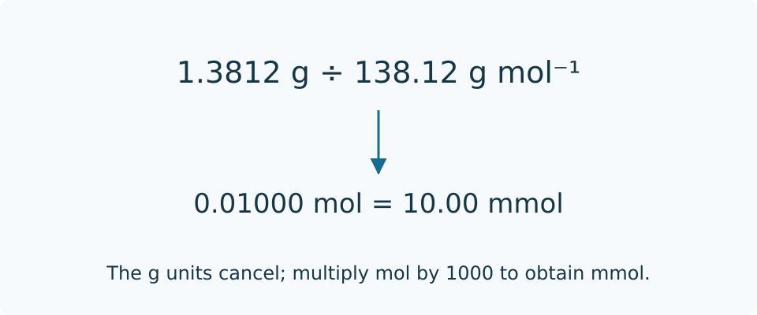{width=85% fig-alt="Mass divided by molar mass gives chemical amount"}

Which units cancel in 1.3812 g divided by 138.12 g/mol?

::: notes
Suggested 40 seconds; adjust to the explanation and class response. Ask students to inspect the indicated molecular feature rather than read the answer caption. Worked answer: Grams cancel, leaving mol: 0.01000 mol or 10.00 mmol salicylic acid.
:::

## Resolve: convert mass to chemical amount

{width=85% fig-alt="Mass divided by molar mass gives chemical amount"}

Grams cancel, leaving mol: 0.01000 mol or 10.00 mmol salicylic acid.

::: notes
Suggested 30 seconds; adjust to the explanation and class response. Use a second inspection focus: justify the result by the atom, charge, ratio or observation involved. Next application answer: 0.01500 mol = 15.00 mmol. Different molar masses prevent direct comparison of reagent masses.
:::

## Apply: convert mass to chemical amount

Convert 1.53135 g anhydride using 102.09 g/mol.

::: notes
Suggested 60 seconds; adjust to the explanation and class response. Allow a brief paper or pair check within this slide. Worked answer: 0.01500 mol = 15.00 mmol. Different molar masses prevent direct comparison of reagent masses.
:::

## Compare available reaction extents

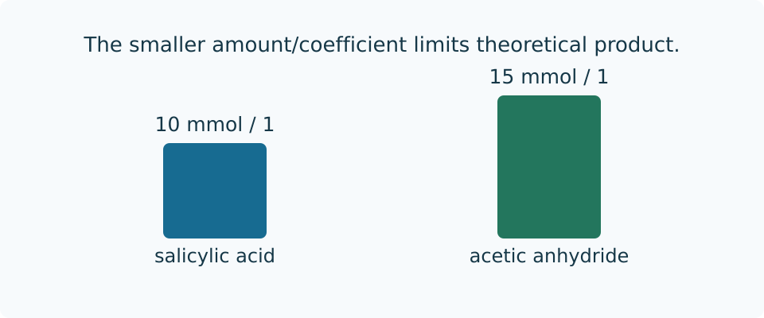{width=85% fig-alt="Compare amount divided by stoichiometric coefficient"}

Which starting amount gives the smaller n/coefficient?

::: notes
Suggested 40 seconds; adjust to the explanation and class response. Ask students to inspect the indicated molecular feature rather than read the answer caption. Worked answer: 10.0 mmol/1 is smaller than 15.0 mmol/1, so salicylic acid limits theoretical aspirin formation.
:::

## Resolve: compare available reaction extents

{width=85% fig-alt="Compare amount divided by stoichiometric coefficient"}

10.0 mmol/1 is smaller than 15.0 mmol/1, so salicylic acid limits theoretical aspirin formation.

::: notes
Suggested 30 seconds; adjust to the explanation and class response. Use a second inspection focus: justify the result by the atom, charge, ratio or observation involved. Next application answer: No. Convert masses to amounts and include balanced coefficients before comparing.
:::

## Apply: compare available reaction extents

Does the smaller gram mass always identify the limiting reagent?

::: notes
Suggested 60 seconds; adjust to the explanation and class response. Allow a brief paper or pair check within this slide. Worked answer: No. Convert masses to amounts and include balanced coefficients before comparing.
:::

## Transfer the rule to another equation

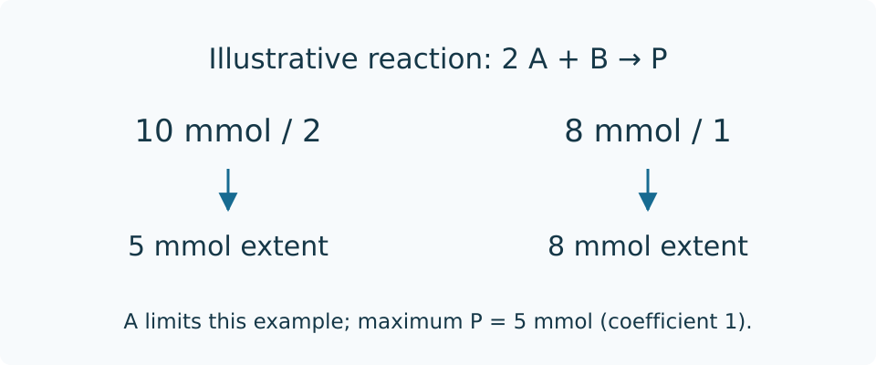{width=85% fig-alt="Stoichiometric coefficients change the limiting comparison"}

For 2A + B → P, compare 10 mmol A and 8 mmol B.

::: notes
Suggested 40 seconds; adjust to the explanation and class response. Ask students to inspect the indicated molecular feature rather than read the answer caption. Worked answer: A gives 5 mmol extent while B gives 8 mmol; A limits and at most 5 mmol P can form.
:::

## Resolve: transfer the rule to another equation

{width=85% fig-alt="Stoichiometric coefficients change the limiting comparison"}

A gives 5 mmol extent while B gives 8 mmol; A limits and at most 5 mmol P can form.

::: notes
Suggested 30 seconds; adjust to the explanation and class response. Use a second inspection focus: justify the result by the atom, charge, ratio or observation involved. Next application answer: The limiting extent is still 5 mmol, but maximum product amount would be 2×5 = 10 mmol.
:::

## Apply: transfer the rule to another equation

What changes if the product coefficient were two?

::: notes
Suggested 60 seconds; adjust to the explanation and class response. Allow a brief paper or pair check within this slide. Worked answer: The limiting extent is still 5 mmol, but maximum product amount would be 2×5 = 10 mmol.
:::

## Change one input and predict first

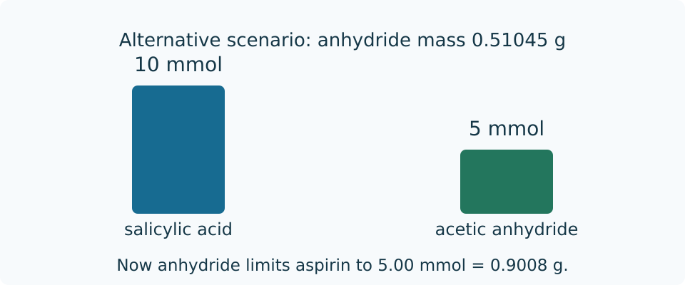{width=85% fig-alt="Changing one input can change the limiting reagent"}

If anhydride is reduced to 0.51045 g, does the original limiting reagent remain limiting?

::: notes
Suggested 40 seconds; adjust to the explanation and class response. Ask students to inspect the indicated molecular feature rather than read the answer caption. Worked answer: That mass is 5.00 mmol anhydride, so it now limits the 1:1 reaction instead of the 10.0 mmol acid.
:::

## Resolve: change one input and predict first

{width=85% fig-alt="Changing one input can change the limiting reagent"}

That mass is 5.00 mmol anhydride, so it now limits the 1:1 reaction instead of the 10.0 mmol acid.

::: notes
Suggested 30 seconds; adjust to the explanation and class response. Use a second inspection focus: justify the result by the atom, charge, ratio or observation involved. Next application answer: 0.00500 mol × 180.16 g/mol = 0.9008 g.
:::

## Apply: change one input and predict first

Calculate the new maximum aspirin mass with M = 180.16 g/mol.

::: notes
Suggested 60 seconds; adjust to the explanation and class response. Allow a brief paper or pair check within this slide. Worked answer: 0.00500 mol × 180.16 g/mol = 0.9008 g.
:::

## Calculate theoretical product mass

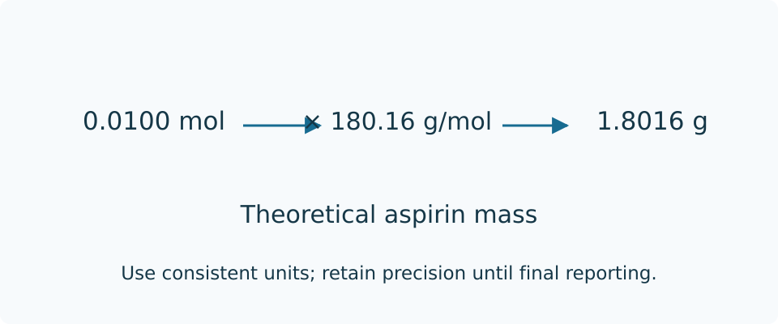{width=85% fig-alt="Theoretical mass is a stoichiometric prediction"}

What does the supplied 10.0 mmol limit predict in grams?

::: notes
Suggested 40 seconds; adjust to the explanation and class response. Ask students to inspect the indicated molecular feature rather than read the answer caption. Worked answer: 0.0100 mol × 180.16 g/mol = 1.8016 g theoretical aspirin before final rounding.
:::

## Resolve: calculate theoretical product mass

{width=85% fig-alt="Theoretical mass is a stoichiometric prediction"}

0.0100 mol × 180.16 g/mol = 1.8016 g theoretical aspirin before final rounding.

::: notes
Suggested 30 seconds; adjust to the explanation and class response. Use a second inspection focus: justify the result by the atom, charge, ratio or observation involved. Next application answer: No. It is the maximum from stoichiometric availability under the assumed desired transformation.
:::

## Apply: calculate theoretical product mass

Does this prediction prove complete conversion?

::: notes
Suggested 60 seconds; adjust to the explanation and class response. Allow a brief paper or pair check within this slide. Worked answer: No. It is the maximum from stoichiometric availability under the assumed desired transformation.
:::

## Use the independently measured isolated mass

{width=85% fig-alt="Isolated yield compares recovered mass with theoretical mass"}

How does 1.20 g compare with 1.8016 g theoretical?

::: notes
Suggested 40 seconds; adjust to the explanation and class response. Ask students to inspect the indicated molecular feature rather than read the answer caption. Worked answer: 100×1.20/1.8016 ≈ 66.6% apparent isolated yield, assuming the material weighed is product.
:::

## Resolve: use the independently measured isolated mass

{width=85% fig-alt="Isolated yield compares recovered mass with theoretical mass"}

100×1.20/1.8016 ≈ 66.6% apparent isolated yield, assuming the material weighed is product.

::: notes
Suggested 30 seconds; adjust to the explanation and class response. Use a second inspection focus: justify the result by the atom, charge, ratio or observation involved. Next application answer: 100×1.10/1.8016 ≈ 61.1%; only the numerator changed.
:::

## Apply: use the independently measured isolated mass

What is the approximate yield for 1.10 g with the same starting amounts?

::: notes
Suggested 60 seconds; adjust to the explanation and class response. Allow a brief paper or pair check within this slide. Worked answer: 100×1.10/1.8016 ≈ 61.1%; only the numerator changed.
:::

## Inspect the mass–yield relationship

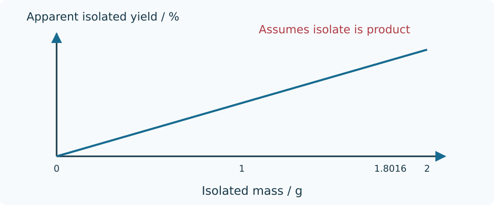{width=85% fig-alt="A mass-based yield scales with recovered mass"}

Why is the line straight when theoretical mass stays fixed?

::: notes
Suggested 40 seconds; adjust to the explanation and class response. Ask students to inspect the indicated molecular feature rather than read the answer caption. Worked answer: Yield is a constant factor times isolated mass. Linearity reflects the calculation, not experimental evidence for identity.
:::

## Apply: inspect the mass–yield relationship

Would an apparent value above 100% demonstrate an excellent synthesis?

::: notes
Suggested 60 seconds; adjust to the explanation and class response. Allow a brief paper or pair check within this slide. Worked answer: It calls the product-mass assumption or inputs into question; residual solvent, impurities or calculation errors can inflate the value.
:::

## Read the plate as a separation observation

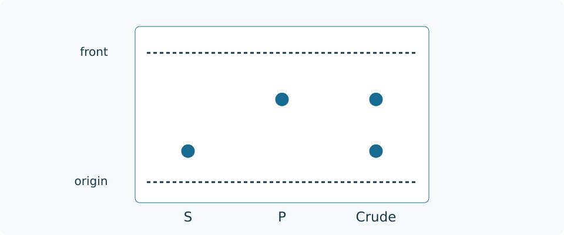{width=85% fig-alt="Simulated TLC: crude contains two visible components"}

What do two visible crude spots support under these conditions?

::: notes
Suggested 40 seconds; adjust to the explanation and class response. Ask students to inspect the indicated molecular feature rather than read the answer caption. Worked answer: At least two detected components are present, with retention consistent with starting/product references in this example.
:::

## Apply: read the plate as a separation observation

Can their relative spot darkness directly give conversion?

::: notes
Suggested 60 seconds; adjust to the explanation and class response. Allow a brief paper or pair check within this slide. Worked answer: Not without a validated quantitative detection relationship; response and visualisation can differ among compounds.
:::

## Measure from a common origin

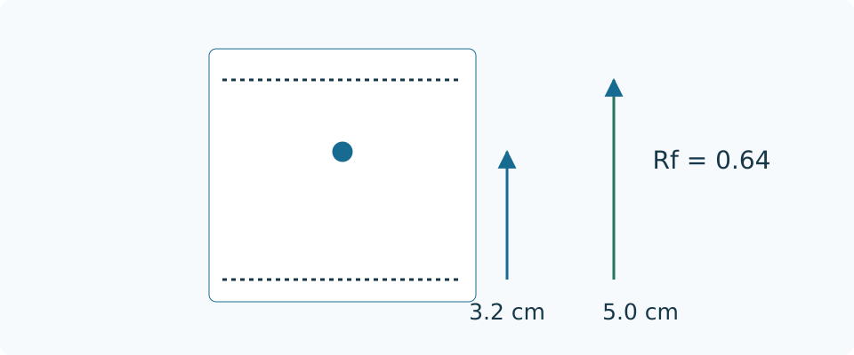{width=85% fig-alt="Measure both TLC distances from the same origin"}

Which two distances enter Rf for the product reference?

::: notes
Suggested 40 seconds; adjust to the explanation and class response. Ask students to inspect the indicated molecular feature rather than read the answer caption. Worked answer: Spot centre 3.2 cm divided by solvent-front distance 5.0 cm gives Rf 0.64. Both start at the baseline.
:::

## Resolve: measure from a common origin

{width=85% fig-alt="Measure both TLC distances from the same origin"}

Spot centre 3.2 cm divided by solvent-front distance 5.0 cm gives Rf 0.64. Both start at the baseline.

::: notes
Suggested 30 seconds; adjust to the explanation and class response. Use a second inspection focus: justify the result by the atom, charge, ratio or observation involved. Next application answer: Dimensionless, because the same distance units cancel.
:::

## Apply: measure from a common origin

What are the units of Rf?

::: notes
Suggested 60 seconds; adjust to the explanation and class response. Allow a brief paper or pair check within this slide. Worked answer: Dimensionless, because the same distance units cancel.
:::

## Interpret the numerical Rf

{width=85% fig-alt="Rf measures distance relative to the solvent front"}

Why compare samples on the same plate and conditions?

::: notes
Suggested 40 seconds; adjust to the explanation and class response. Ask students to inspect the indicated molecular feature rather than read the answer caption. Worked answer: Rf depends on eluent, stationary phase and conditions. Reference comparison is more meaningful when those factors match.
:::

## Apply: interpret the numerical Rf

Could an Rf measured in another eluent uniquely confirm identity?

::: notes
Suggested 60 seconds; adjust to the explanation and class response. Allow a brief paper or pair check within this slide. Worked answer: No. Different conditions change retention, and even matching values are not unique molecular identifiers.
:::

## Recognise an uncomputable quantity

{width=85% fig-alt="A TLC front must be recorded before calculating Rf"}

Can spot distance alone reconstruct a reliable Rf?

::: notes
Suggested 40 seconds; adjust to the explanation and class response. Ask students to inspect the indicated molecular feature rather than read the answer caption. Worked answer: No. Without the solvent-front distance, the denominator is unknown. Do not invent a typical front travel.
:::

## Apply: recognise an uncomputable quantity

What primary observation should have been recorded?

::: notes
Suggested 60 seconds; adjust to the explanation and class response. Allow a brief paper or pair check within this slide. Worked answer: The solvent-front position relative to the same origin, normally marked while it is observable.
:::

## Test the one-spot inference

{width=85% fig-alt="Two compounds can co-migrate on a TLC plate"}

How can two compounds produce one TLC spot in this example?

::: notes
Suggested 40 seconds; adjust to the explanation and class response. Ask students to inspect the indicated molecular feature rather than read the answer caption. Worked answer: They can have the same retention and co-migrate. Other components might also be invisible under the detection method.
:::

## Apply: test the one-spot inference

What modest conclusion is supported by a single visible spot?

::: notes
Suggested 60 seconds; adjust to the explanation and class response. Allow a brief paper or pair check within this slide. Worked answer: One detected retention feature under that separation and detection condition, not unique identity or guaranteed purity.
:::

## Compare TLC with independent evidence

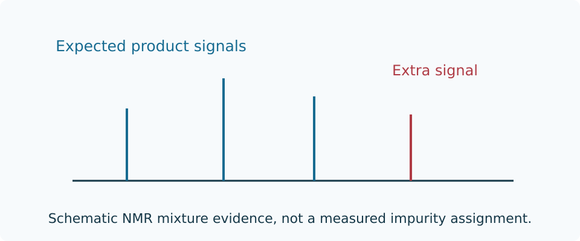{width=85% fig-alt="A mixture can add signals without changing a single TLC spot"}

What does an extra major NMR signal ask you to investigate?

::: notes
Suggested 40 seconds; adjust to the explanation and class response. Ask students to inspect the indicated molecular feature rather than read the answer caption. Worked answer: A mixture, residual solvent, starting material or an incorrect assignment could contribute. Do not name a unique impurity without enough evidence.
:::

## Resolve: compare TLC with independent evidence

{width=85% fig-alt="A mixture can add signals without changing a single TLC spot"}

A mixture, residual solvent, starting material or an incorrect assignment could contribute. Do not name a unique impurity without enough evidence.

::: notes
Suggested 30 seconds; adjust to the explanation and class response. Use a second inspection focus: justify the result by the atom, charge, ratio or observation involved. Next application answer: No. The yield calculation assumes product mass; contradictory identity/purity evidence tests that assumption.
:::

## Apply: compare TLC with independent evidence

Should a high isolated yield overrule contradictory NMR?

::: notes
Suggested 60 seconds; adjust to the explanation and class response. Allow a brief paper or pair check within this slide. Worked answer: No. The yield calculation assumes product mass; contradictory identity/purity evidence tests that assumption.
:::

## Predict retained and changed spectral motifs

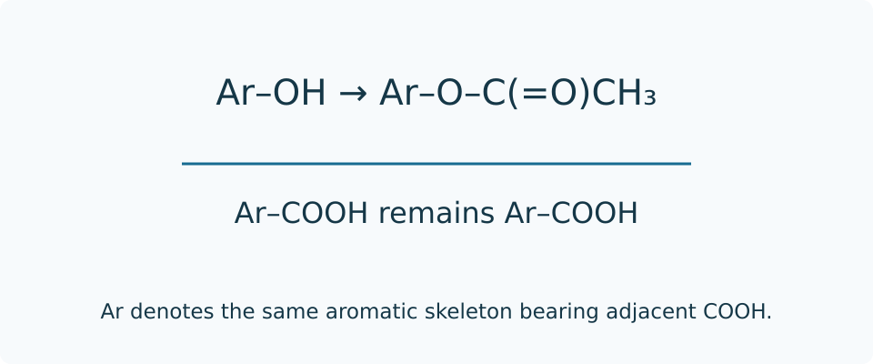{width=85% fig-alt="The acid group is retained while the phenolic OH is acetylated"}

Why can an acid-region feature remain in an aspirin-like product?

::: notes
Suggested 40 seconds; adjust to the explanation and class response. Ask students to inspect the indicated molecular feature rather than read the answer caption. Worked answer: The carboxylic acid group is retained. Phenolic acetylation creates an ester but does not remove all O–H functionality.
:::

## Apply: predict retained and changed spectral motifs

Which starting-group interpretation would be too strong from acid O–H alone?

::: notes
Suggested 60 seconds; adjust to the explanation and class response. Allow a brief paper or pair check within this slide. Worked answer: Calling every acid O–H feature unreacted salicylic acid would be unjustified; the target itself contains an acid.
:::

## Use product spectra with the target structure

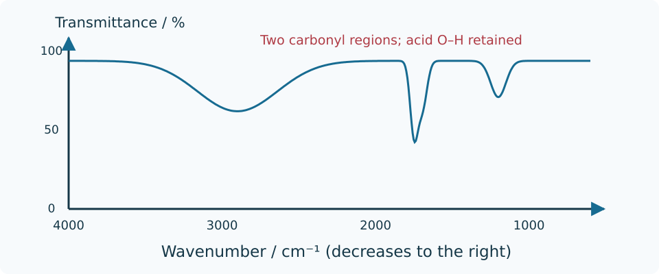{width=85% fig-alt="Simulated aspirin-like IR teaching trace"}

Which combination is consistent with acid plus ester functions?

::: notes
Suggested 40 seconds; adjust to the explanation and class response. Ask students to inspect the indicated molecular feature rather than read the answer caption. Worked answer: Carbonyl evidence for the two motifs and retained acid features are consistent with the aspirin-like target, but the simulated trace is not unique proof.
:::

## Apply: use product spectra with the target structure

Why label this trace simulated rather than measured?

::: notes
Suggested 60 seconds; adjust to the explanation and class response. Allow a brief paper or pair check within this slide. Worked answer: It was constructed for teaching and does not document an actual isolation; provenance limits the claims it supports.
:::

## Keep the two mass inputs independent

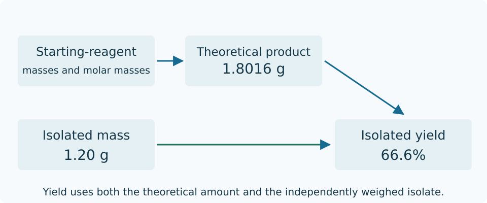{width=85% fig-alt="Trace a reported result back to its observations"}

Which measurements determine theoretical mass, and which enters yield separately?

::: notes
Suggested 40 seconds; adjust to the explanation and class response. Ask students to inspect the indicated molecular feature rather than read the answer caption. Worked answer: Starting-reagent masses and molar masses determine theoretical product. Independently weighed isolate mass enters the yield numerator.
:::

## Apply: keep the two mass inputs independent

What should happen when only isolated mass changes in an Rmd report?

::: notes
Suggested 60 seconds; adjust to the explanation and class response. Allow a brief paper or pair check within this slide. Worked answer: Calculated yield should update; theoretical product amount should stay fixed. A fresh Knit should reconstruct both from saved inputs.
:::

## Integrate one short case

A 1:1 teaching reaction uses 10.0 mmol limiting reagent; product M = 180.16 g/mol and isolate = 1.20 g. Give theoretical mass, apparent yield and one limitation.

::: notes
Suggested 120 seconds; adjust to the explanation and class response. Give time to formulate the claim and compare a partner explanation. Worked answer: Theoretical mass is 1.8016 g and apparent isolated yield about 66.6%. The isolate may contain impurities or solvent, so mass alone does not establish purity.
:::

## Compare the worked reasoning

Theoretical mass is 1.8016 g and apparent isolated yield about 66.6%. The isolate may contain impurities or solvent, so mass alone does not establish purity.

::: notes
Suggested 60 seconds; adjust to the explanation and class response. Ask students to identify the exact step or observation their own reasoning omitted. This is a correction interval within the session, not a new topic.
:::

## Exit explanation

Why does one visible TLC spot not prove pure product?

::: notes
Suggested 40 seconds; adjust to the explanation and class response. Worked answer: Co-migration and invisible components can hide a mixture; combine evidence under suitable conditions. Ask for a causal explanation, not a single vocabulary label.
:::

## Continue with independent practice

Use the [exercises](exercise.qmd), then the [self-check](quiz.qmd).

All required inputs and explanations are provided locally. The [reading guide](../reference/reading.qmd) offers optional textbook support.

::: notes
Suggested 20 seconds; adjust to the explanation and class response. Preview the local exercise route. No book purchase or external problem set is needed to complete it. Leave time to note one corrected misconception.
:::
