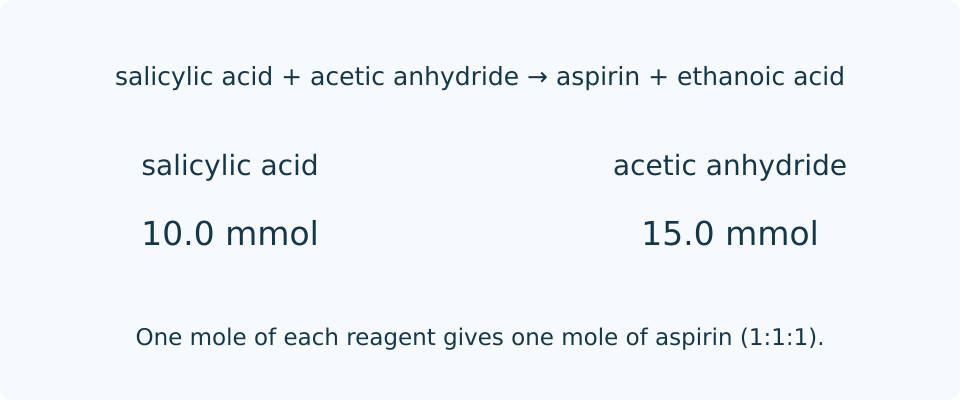
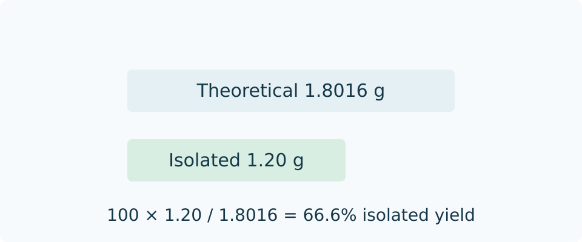
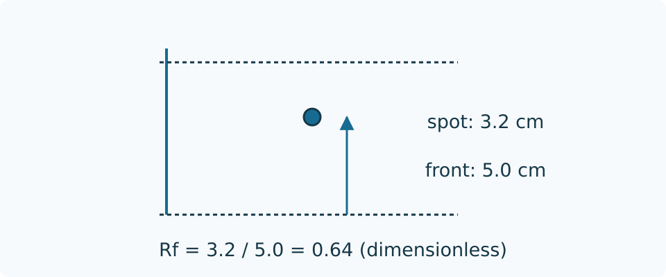
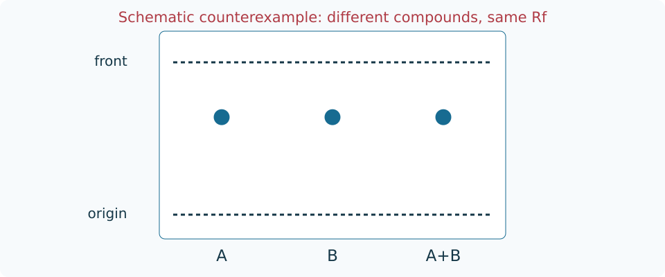

## What will you be able to explain?

- Plan a short route using known functional-group changes.
- Calculate limiting reagent, theoretical amount and isolated yield with units.
- Evaluate identity and purity separately from the recovered mass.

::: notes
Start with a drawn molecule and an explanation from the preceding unit. Ask students to predict before revealing an answer. Use the practice page for complete worked checks rather than putting dense paragraphs on slides.
:::

## Plan with functional groups

{width=85% fig-alt="Oxidation followed by esterification connects ethanol, ethanoic acid and ethyl ethanoate."}

Choose a target transformation before selecting conditions.

::: notes
The route uses a separate ethanol portion in the esterification stage. Strong oxidation to the acid requires suitable conditions; controlled aldehyde isolation is a different objective. These are planning examples, not laboratory instructions.
:::

## Balance before calculating

{width=85% fig-alt="The aspirin teaching example uses one salicylic acid and one acetic anhydride per aspirin."}

The other product is ethanoic acid; do not drop atoms from the equation.

::: notes
The sample masses and yields are simulated. The acetylation changes the phenolic OH into an ester while retaining the salicylic-acid carboxyl group.
:::

## Find the limiting reagent

{width=85% fig-alt="10.0 mmol/1 is less than 15.0 mmol/1, so salicylic acid limits theoretical aspirin."}

Compare n divided by its stoichiometric coefficient, not the masses.

::: notes
The smaller mass need not be limiting. A change in stoichiometry would change the comparison even if the measured amounts stayed the same.
:::

## Predict the maximum product mass

{width=85% fig-alt="0.0100 mol times 180.16 g/mol gives 1.8016 g theoretical aspirin."}

Keep units visible and round the final reported result appropriately.

::: notes
The word theoretical describes the stoichiometric upper bound under assumed complete conversion and no competing pathways. It is not a guarantee of product formation.
:::

## Calculate isolated yield

{width=85% fig-alt="An isolated mass of 1.20 g corresponds to 66.6% of the theoretical mass."}

A mass-based yield assumes that the weighed material is the stated product.

::: notes
Residual solvent, water or impurities can inflate the apparent mass. Do not call this conversion, and do not claim purity solely from a plausible percentage.
:::

## Read a TLC comparison

{width=85% fig-alt="The simulated crude lane has spots matching starting-material and product references under the same conditions."}

A reference match supports a comparison, not unique identification.

::: notes
The plate is a schematic of supplied teaching observations. TLC retention depends on stationary phase, eluent and conditions; Rf is not a compound-specific constant.
:::

## Measure from the origin

{width=85% fig-alt="For a 3.2 cm spot and 5.0 cm solvent-front travel, Rf = 0.64."}

Both distances start at the same baseline; the ratio has no units.

::: notes
Measure the spot centre consistently. If the solvent front is unknown or runs off the plate, an Rf cannot be reliably reconstructed from this drawing.
:::

## Ask which functional groups remain

{width=85% fig-alt="An aspirin-like teaching trace retains acid features and adds ester evidence."}

Check the expected product structure rather than assuming every starting-material feature should disappear.

::: notes
The carboxylic acid remains after phenolic acetylation. Do not interpret persistent acid O–H as automatic proof of unreacted salicylic acid; the phenolic and acid OH regions require care.
:::

## One spot need not mean one compound

{width=85% fig-alt="Two distinct compounds can have the same Rf in one eluent."}

Complement TLC with spectral evidence and other suitable purity checks.

::: notes
Co-migration is a counterexample to the inference “one spot proves pure”. A mixture can also contain components invisible under the chosen detection method.
:::

## Keep the calculation reproducible

{width=85% fig-alt="Saved raw mass and an amount table feed an Rmd calculation and report."}

Changing an input and knitting again should update every dependent result.

::: notes
Students should keep raw observations separate from derived columns. Rerendering does not validate whether the raw record or the chemical model is correct; each also needs checking.
:::

## Work one example on paper

Using 1.3812 g salicylic acid (138.12 g/mol) and 1.53135 g acetic anhydride (102.09 g/mol), calculate both amounts, theoretical aspirin mass and yield from 1.20 g isolated material. Explain why these numbers cannot establish purity.

::: notes
Allow independent thinking, then compare in pairs. Ask students to defend each atom, charge or assignment. Show the worked check only after a first attempt.
:::

## A common mistake to repair

“66.6% yield” and “66.6% pure” answer different questions. Also distinguish isolated yield from starting-material conversion and product selectivity.

Explain the correction using a drawing or a specific observation.

## Test your explanation

1. Which atoms, bonds or observations support the claim?
2. What alternative would make a different prediction?
3. What assumption limits the conclusion?

Give a partner your explanation without the answer label. Can they follow it?

## Take the reasoning forward

Complete the [practice and worked examples](exercise.qmd) and [self-check](quiz.qmd).

Selected Solomons chapters 8, 12 and 17 sections; see the [reading guide](../reference/reading.qmd) for the provisional textbook map and open references.
